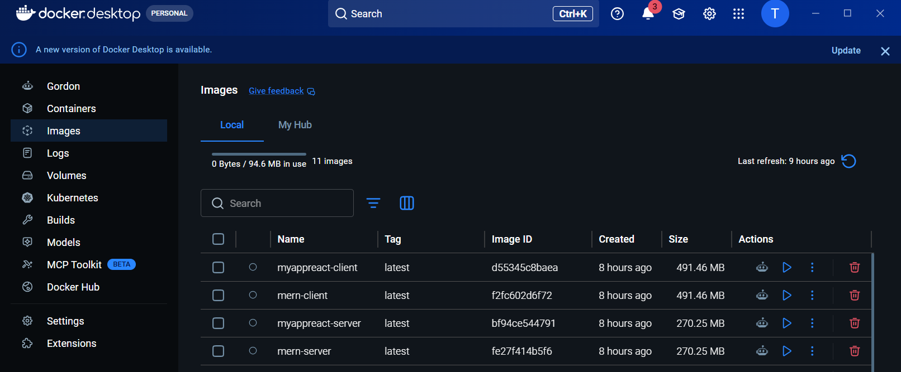
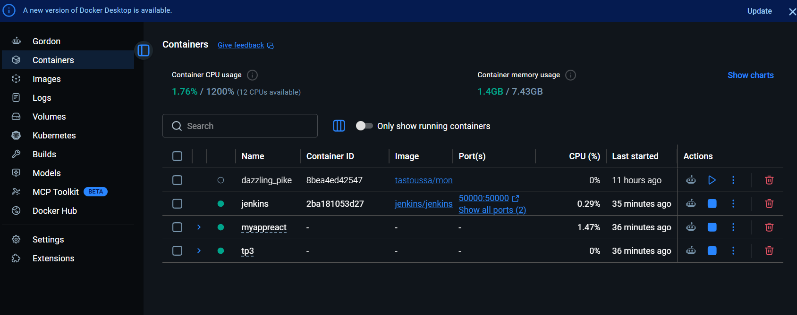
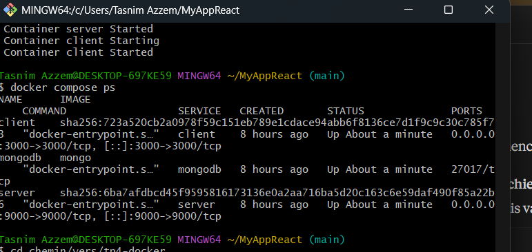
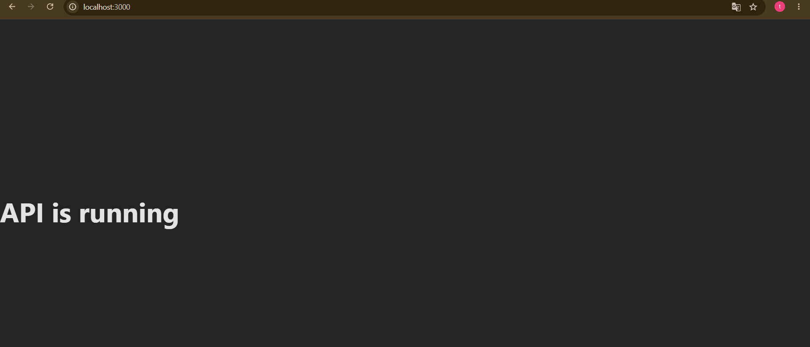
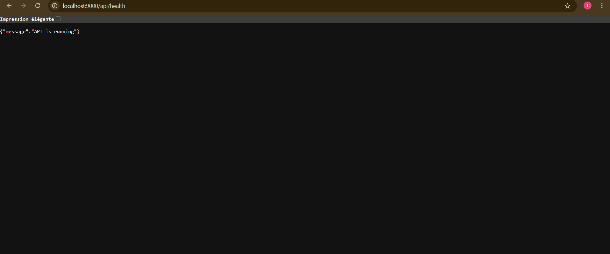
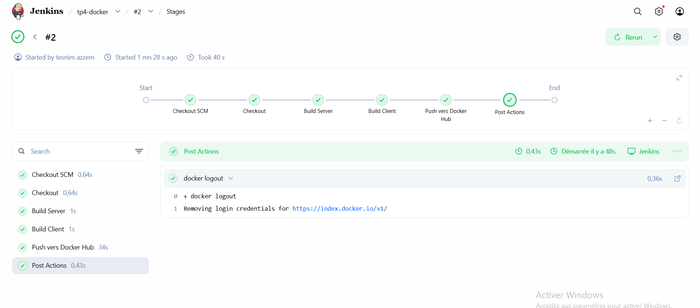
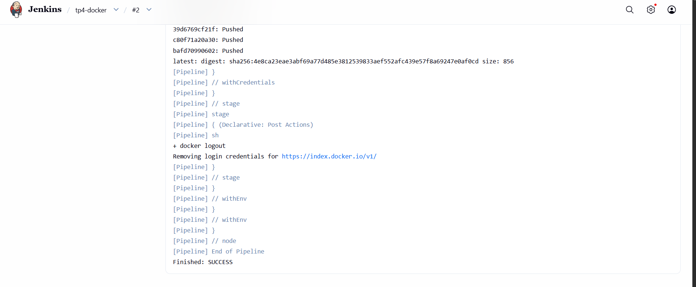
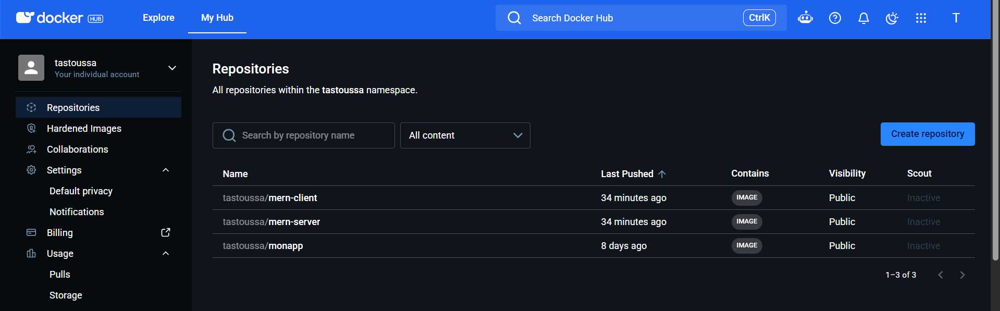

# TP4 : Docker et Docker Compose

**Étudiante :** Tasnim Azzem, 3 LIG G01, ISG de Sousse
**Matière :** Introduction au DevOps

## Objectif

Conteneuriser une application MERN (MongoDB, Express, React, Node.js), l'orchestrer avec Docker Compose, puis automatiser la construction et la publication des images avec Jenkins.

## Liens

- GitHub : https://github.com/tesnimazzem/tp4-docker
- Docker Hub (serveur) : https://hub.docker.com/r/tastoussa/mern-server
- Docker Hub (client) : https://hub.docker.com/r/tastoussa/mern-client

## Structure du projet

- `Client/` : application React (Vite) + Dockerfile
- `Server/` : API Express + Dockerfile
- `docker-compose.yml` : orchestration des 3 services
- `Jenkinsfile` : pipeline CI/CD

## Étape 1 : Cloner le projet

```bash
git clone https://github.com/wiem-kb/MyAppReact.git
```

Cette commande récupère le code source fourni (dossiers `client` et `server`). Le projet a ensuite été publié sur mon propre dépôt GitHub.

## Étape 2 : Créer les Dockerfiles

Un Dockerfile décrit les instructions pour construire une image.

### Serveur (`Server/Dockerfile`)

- `FROM node:lts-alpine` : image de base Node légère.
- `WORKDIR /app` : dossier de travail dans le conteneur.
- `COPY package*.json ./` puis `RUN npm install` : on copie d'abord les `package.json` pour profiter du cache Docker, puis on installe les dépendances.
- `COPY . .` : copie du reste du code.
- `EXPOSE 9000` : port de l'API.
- `CMD ["npm", "start"]` : démarrage de l'application.

La variable `MONGO_URI` (connexion à MongoDB) est fournie au démarrage, pas dans l'image.

### Client (`Client/Dockerfile`)

- Même base `node:lts-alpine`, même installation des dépendances.
- `RUN npm run build` : construit l'application React en fichiers statiques.
- `RUN npm install -g serve` : installe un serveur HTTP léger.
- `EXPOSE 3000` : port du client.
- `CMD` : lance `serve` pour servir les fichiers de build.

## Étape 3 : Construire les images

```bash
docker build -t mern-server ./Server
docker build -t mern-client ./Client
```

`-t` donne un nom à l'image, et le dernier argument est le dossier contenant le Dockerfile.



## Étape 4 : Créer un réseau Docker

```bash
docker network create mern-network
```

Les conteneurs d'un même réseau peuvent se joindre par leur nom (par exemple le serveur contacte `mongodb`).

## Étape 5 : Lancer les conteneurs

```bash
docker run -d --name mongodb --network mern-network mongo
docker run -d --name server --network mern-network -p 9000:9000 -e MONGO_URI=mongodb://mongodb:27017/mydb mern-server
docker run -d --name client --network mern-network -p 3000:3000 mern-client
```

- `-d` : exécution en arrière-plan.
- `--name` : nom du conteneur.
- `--network` : rattache le conteneur au réseau.
- `-p hôte:conteneur` : rend le port accessible depuis mon PC.
- `-e` : définit une variable d'environnement.



Avant l'étape suivante, j'arrête ces conteneurs pour libérer les ports :

```bash
docker rm -f client server mongodb
```

## Étape 6 : Docker Compose

Le fichier `docker-compose.yml` décrit les trois services au même endroit :

- `mongodb` : image `mongo`, conteneur `mongodb`, réseau `mern-network`.
- `server` : build depuis `./Server`, port 9000, variable `MONGO_URI`, `depends_on: mongodb`.
- `client` : build depuis `./Client`, port 3000, `depends_on: server`.
- Réseau `mern-network` avec le driver `bridge`.

Lancement :

```bash
docker compose up --build
```

`--build` reconstruit les images avant de démarrer. Une seule commande remplace toutes les commandes de l'étape 5.



## Étape 7 : Tests

- Client : http://localhost:3000



- API : http://localhost:9000/api/health



## Étape 8 : Pipeline Jenkins

### Installation de Jenkins

Jenkins est lancé dans un conteneur Docker, avec accès au Docker de la machine :

```bash
docker run -d --name jenkins -p 9090:8080 -p 50000:50000 \
  -v jenkins_home:/var/jenkins_home \
  -v //var/run/docker.sock:/var/run/docker.sock \
  --user root jenkins/jenkins:lts-jdk17
```

Puis installation du client Docker dans le conteneur :

```bash
docker exec -u root jenkins sh -c "apt-get update && apt-get install -y docker.io"
```

Jenkins est accessible sur http://localhost:9090.

### Identifiants Docker Hub

Un token d'accès (droits Read & Write) a été créé sur Docker Hub, puis enregistré dans Jenkins (_Administrer Jenkins > Credentials_) avec l'ID `dockerhub-credentials`. Le token évite d'écrire le mot de passe dans le code.

### Le Jenkinsfile

Le pipeline a 4 étapes :

1. **Checkout** : récupère le code depuis GitHub.
2. **Build Server** : construit l'image `tastoussa/mern-server`.
3. **Build Client** : construit l'image `tastoussa/mern-client`.
4. **Push vers Docker Hub** : connexion avec les identifiants, puis envoi des deux images.

### Job Pipeline

Job de type _Pipeline_, avec _Pipeline script from SCM_, Git, dépôt `https://github.com/tesnimazzem/tp4-docker.git`, branche `*/main`, script `Jenkinsfile`.




Remarque : un premier build a échoué avec l'erreur `access token has insufficient scopes`, car le token n'avait pas le droit d'écriture. Il a été corrigé en créant un token **Read & Write**.

## Étape 9 : Images sur Docker Hub

Les images publiées par le pipeline sont visibles sur Docker Hub :



